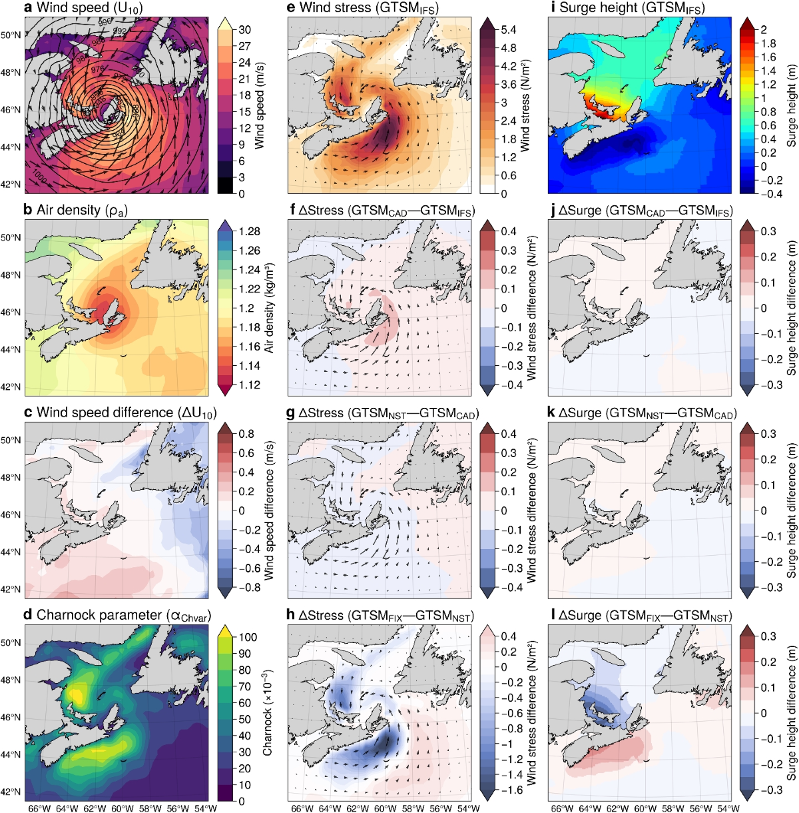
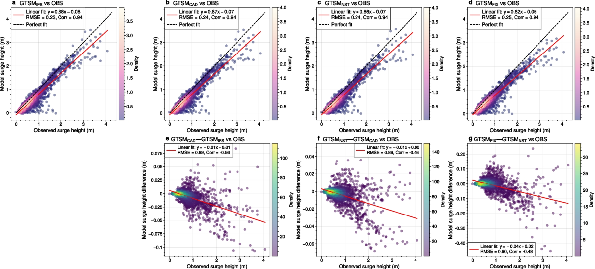

# Sea-surface drag experiments for global storm-surge modelling

Workflow that turns ERA5 reanalysis into atmospheric forcing for four sea-surface drag experiments with the Global Tide and Surge Model (GTSM, Delft3D Flexible Mesh), sets up the yearly model runs (2006–2015) on the Snellius supercomputer, and makes the figures of the paper.

  
   <em>Hurricane Fiona (2022): ERA5 fields, wind stress and surge in the drag experiments (Fig. 7 of the paper).</em>

It accompanies:

> Özkan, F.N., Verlaan, M., Muis, S., Zijl, F. (2025). Sensitivity of global storm surge modelling to sea surface drag. *Ocean Dynamics*, 75, 66. https://doi.org/10.1007/s10236-025-01713-3

Model output used in the paper: [4TU.ResearchData, doi:10.4121/923c1f55-01f7-4140-b9ce-ab3be5a617c7](https://doi.org/10.4121/923c1f55-01f7-4140-b9ce-ab3be5a617c7)

## The experiments

Each experiment adds one more piece of the ERA5 (ECMWF IFS) surface-stress formulation to GTSM's wind forcing, so its effect on surge levels can be isolated.

| Code name | Paper name | Wind given to GTSM | Charnock parameter |
|---|---|---|---|
| `1-CC` | FIX: fixed drag | 10 m wind | constant (0.041) |
| `2-CV` | NST: no stability correction | 10 m wind | ERA5, varies with sea state |
| `3-UV10N` | CAD: constant air density | 10 m neutral wind | ERA5 |
| `4-UV10RHO` | IFS: IFS-style drag | stress-equivalent wind | ERA5 |

All experiments also use ERA5 mean sea-level pressure. GTSM computes the drag coefficient from the Charnock relation.

## Stress-equivalent wind

GTSM computes the wind stress with a constant air density, $\rho_{ref} = 1.2\ \mathrm{kg\,m^{-3}}$, whereas ERA5 uses the actual density of the air. For the `4-UV10RHO` experiment, [`03_stress_equivalent_wind.py`](era5_forcing/03_stress_equivalent_wind.py) rescales the ERA5 neutral wind so that GTSM, with its constant density, applies the same surface stress as the real air would:

1. **Air density** from 2 m dew point $T_d$, 2 m temperature $T$ and sea-level pressure $p$:

   $$e = e_0 \exp\left(\frac{17.502\,(T_d - T_0)}{T_d - 32.19}\right), \quad q = \frac{e}{p + \epsilon\,(p - e)}, \quad T_v = (1 + \epsilon q)\,T, \quad \rho = \frac{p}{R_d T_v}$$

   with $\epsilon = R_v/R_d - 1$.

2. **Friction velocity** from the neutral wind $U_{10N}$ and the ERA5 Charnock parameter $\alpha$, solving iteratively

   $$u_* = \frac{\kappa\,U_{10N}}{\ln(z/z_0)}, \qquad z_0 = \frac{\alpha\,u_*^2}{g}$$

3. **Density correction** of the friction velocity, then back to a 10 m wind with the logarithmic profile:

   $$u_{*\rho} = u_* \sqrt{\rho/\rho_{ref}}, \qquad U_{\rho} = \frac{u_{*\rho}}{\kappa}\,\ln\!\left(\frac{z}{z_{0\rho}}\right), \qquad z_{0\rho} = \frac{\alpha\,u_{*\rho}^2}{g}$$

The wind components are scaled by $U_\rho / U_{10N}$, keeping the wind direction. The calculation runs one day at a time, so a full year of global hourly 0.25° fields fits in memory.

## Workflow

| Step | Script | What it does |
|---|---|---|
| 1 | [`01_download_era5.py`](era5_forcing/01_download_era5.py) | Downloads hourly ERA5 fields as monthly files from the Copernicus Climate Data Store |
| 2 | [`02_prepare_run_windows.sh`](era5_forcing/02_prepare_run_windows.sh) | Cuts one file per yearly run (15 Dec – 1 Jan, including 15 days of spin-up), remaps it to the GTSM forcing grid and renames variables for GTSM (CDO) |
| 3 | [`03_stress_equivalent_wind.py`](era5_forcing/03_stress_equivalent_wind.py) | Computes the stress-equivalent wind for `4-UV10RHO` (xarray) |
| 4 | [`04_uv10rho_run_windows.sh`](era5_forcing/04_uv10rho_run_windows.sh) | Merges the daily stress-equivalent winds into run windows |
| 5 | [`05_assemble_experiments.sh`](era5_forcing/05_assemble_experiments.sh) | Merges the variables each experiment needs into one forcing file per run |
| 6 | [`setup_runs.sh`](model_runs/setup_runs.sh) | Creates one GTSM run folder per experiment and year from a template, with forcing, run period and SLURM settings filled in |

Each step is a SLURM job, run from the repository root, e.g. `sbatch era5_forcing/02_prepare_run_windows.sh`. Steps 1 and 3 have `.slurm` wrappers around the Python scripts. Paths, years and experiment names are set in [`config.sh`](config.sh).

## Figures

The [`figures/`](figures) folder has one notebook per figure of the paper, showing how each was made. The processed input files are not included; set `DATA_DIR` at the top of a notebook to your own copy. Model output for the two storms and the annual maxima are on [4TU.ResearchData](https://doi.org/10.4121/923c1f55-01f7-4140-b9ce-ab3be5a617c7). The notebooks use the environment in [`figures/environment.yml`](figures/environment.yml).

| Figure | Notebook | Shows |
|---|---|---|
| 2 | [`fig02_station_map`](figures/fig02_station_map.ipynb) | GTSM output points and GESLA-3 tide gauges |
| 3 | [`fig03_era5_global_fields`](figures/fig03_era5_global_fields.ipynb) | Global ERA5 wind, Charnock parameter, stability and air density |
| 4 | [`fig04_drag_and_stability`](figures/fig04_drag_and_stability.ipynb) | Drag coefficient and atmospheric stability against wind speed |
| 5, 7 | [`fig05_fig07_storm_maps`](figures/fig05_fig07_storm_maps.ipynb) | Storm Xaver (2013) and hurricane Fiona (2022) maps |
| 6 | [`fig06_xaver_validation`](figures/fig06_xaver_validation.ipynb) | Xaver: modelled versus observed surge |
| 8 | [`fig08_fiona_validation`](figures/fig08_fiona_validation.ipynb) | Fiona: modelled versus observed surge |
| 9 | [`fig09_regional_surge_effects`](figures/fig09_regional_surge_effects.ipynb) | Regional effect of air density, stability and Charnock parameter on surge |
| 10 | [`fig10_annual_maxima_vs_observations`](figures/fig10_annual_maxima_vs_observations.ipynb) | Annual-maximum surges at GESLA-3 stations, model versus observations |

  
   <em>Modelled against observed annual-maximum surges at GESLA-3 stations, 2006–2015 (Fig. 10 of the paper).</em>

All published figures are in [`figures/published/`](figures/published). They are reproduced from Özkan et al. (2025), licensed under [CC BY 4.0](https://creativecommons.org/licenses/by/4.0/).

## Requirements

- A [Copernicus Climate Data Store](https://cds.climate.copernicus.eu/) account for step 1
- [CDO](https://code.mpimet.mpg.de/projects/cdo) and the Python packages in [`environment.yml`](environment.yml):
  `conda env create -f environment.yml`
- A GTSM model setup for step 6. GTSM is developed by [Deltares](https://www.deltares.nl/en/expertise/projects/global-tide-and-surge-model); its model files are not part of this repository.

The scripts load Snellius modules (`module load ...`); adapt or remove those lines on other systems.

## Notes

- These are cleaned-up versions of the scripts used for the paper: paths are gathered in `config.sh`, one-off and duplicate scripts are removed, and the steps are renumbered. On test data, the stress-equivalent wind from step 3 is bit-for-bit identical to the original script.
- The figure notebooks contain the original plotting code for the published figures. Only the file paths are changed, and exploratory cells and earlier figure versions are left out. In the code, the experiments still have their working names (`cc`, `cv`, `ntr`, `rho`); the figure labels use the paper names.
- The download script uses the CDS request format of 2023, when the data for the paper were downloaded. Files from the current CDS name the time coordinate `valid_time`; rename it to `time` before step 2.

## Citation

If you use this workflow, please cite the paper above.

## License

MIT, see [LICENSE](LICENSE).
